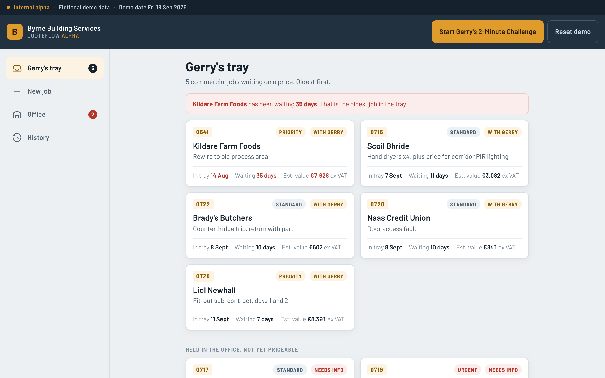
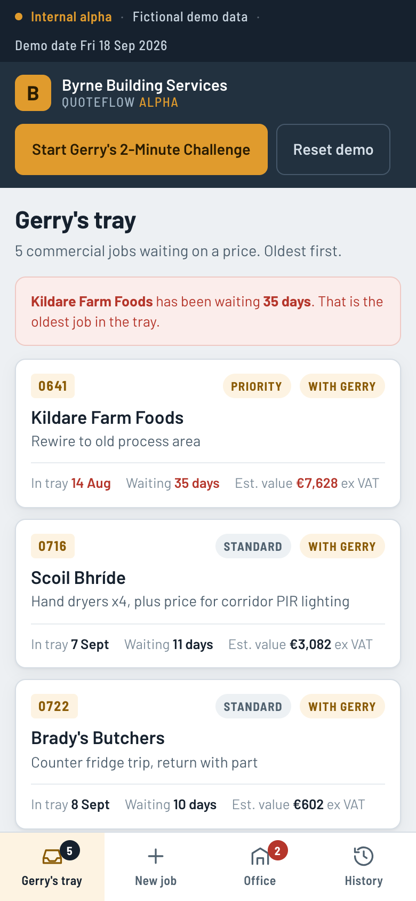
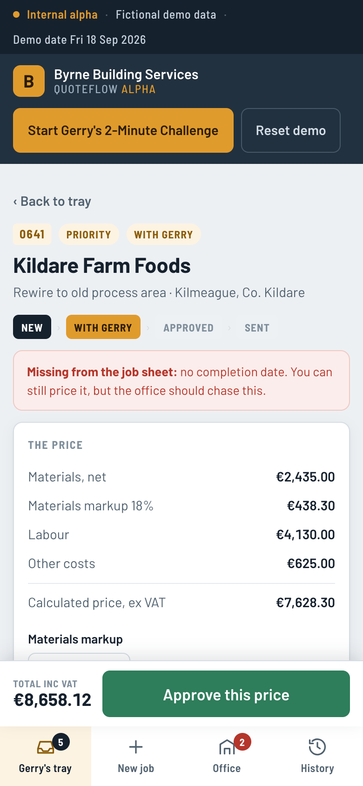
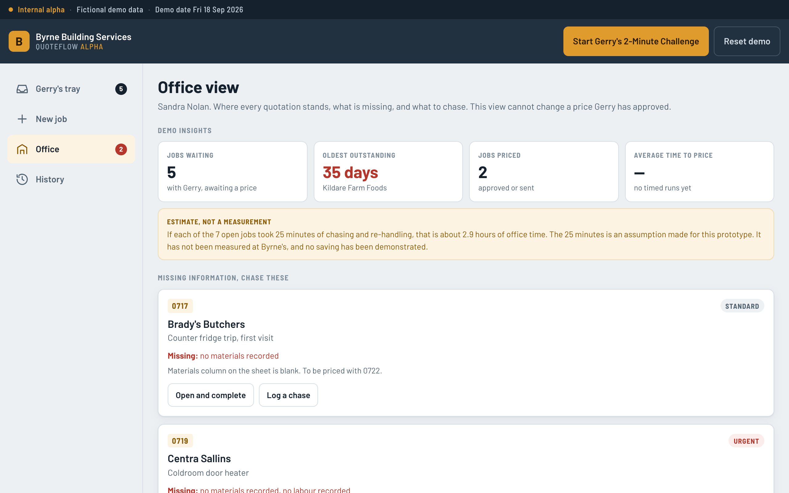

# Byrne's | QuoteFlow Alpha

[](https://github.com/gerardmcandrew-oss/byrne-quote-alpha/actions/workflows/deploy.yml)


An internal alpha for **Byrne Building Services**, built for a Technology for Business
classroom exercise at National College of Ireland.

It does one thing: it gets a commercial job out of Gerry's tray and into a priced,
approved quote, without taking the pricing decision away from him.

**Live:** https://gerardmcandrew-oss.github.io/byrne-quote-alpha/



<table>
  <tr>
    <td width="33%"></td>
    <td width="33%"></td>
    <td width="34%" valign="top">
      <strong>Built for Gerry's phone.</strong><br><br>
      Left: the tray, oldest job first, with days waiting.<br><br>
      Right: the pricing workspace. The price is the first thing on screen, and approval sits on a sticky bar
      that always asks for confirmation.
    </td>
  </tr>
</table>



> Everything in this prototype is fictional. Byrne Building Services, its people, its
> customers and every figure shown are invented for teaching. No real client data is used.
> All labour rates, the materials markup and the VAT line are **demonstration assumptions**,
> not Byrne's commercial rates.

---

## The problem this addresses

Commercial jobs sit in Gerry's tray waiting on a price. From the Case C evidence:

| Finding | Source |
|---|---|
| Nine jobs in the tray, oldest from 14 August | `04-whatsapp-dispatch.txt`, Sandra, 11/09 09:30 |
| That job had been waiting **34 days** | `04-whatsapp-dispatch.txt`, Sandra, 17/09 16:58 |
| About **40 days** from job completion to invoice | `05-voice-memos.txt`, Sandra Nolan |
| Sheets arrive with the materials column blank | `02-job-sheets.txt`, sheets 0713, 0714, 0717 |
| Roughly five sheets a month never come back | `05-voice-memos.txt`, Sandra Nolan |
| The January app failed: eleven taps to close a job, no training | `05-voice-memos.txt`, Tony Keogh |
| "Pricing stays with me" | `04-whatsapp-dispatch.txt`, Gerry, 18/09 12:40 |
| "What I would NOT do is hand pricing to a computer" | `05-voice-memos.txt`, Gerry Byrne |

Two of those shape the whole design. Gerry keeps the pricing decision, and nothing may
take more taps than the app the lads already abandoned.

---

## What it does

| Screen | Who | What it does |
|---|---|---|
| **Gerry's tray** | Gerry, on his phone | Commercial jobs waiting on a price, oldest first, with days waiting. One tap opens a job. |
| **Pricing workspace** | Gerry | Materials, labour and other costs from the office, live totals, and an override so Gerry can set his own figure. Approval is a deliberate action. |
| **New job** | Office | Intake form with validation. A job with no materials or labour is saved anyway and flagged for chasing rather than blocked. |
| **Office view** | Sandra | Progress, what is missing, what to chase, and demo insights. It cannot change an approved price. |
| **History** | Anyone | Every job, its position in the workflow, and a full activity log. |

### Gerry keeps control

- No automatic pricing, sending or approval anywhere in the app.
- The calculated figure is a **starting point**. Gerry can type his own price over it and
  record why. This comes straight from his voice memo about the farm job with old wiring,
  where standard pricing "would be unfair to the client".
- Approving asks for confirmation first, and says plainly that nothing reaches the
  customer until the office sends it.
- Approved and sent jobs are read-only until explicitly reopened.

### The two-minute challenge

**Start Gerry's 2-Minute Challenge** picks the oldest job still waiting, starts a visible
120-second countdown, and drops you into the pricing workspace. The clock stops only when
you actually approve. It never completes the task for you, and if the clock runs out it
says so and changes nothing.

The result screen reports elapsed time **and the number of taps used**, for comparison with
the eleven taps that killed the January rollout.

---

## Workflow

```
New  →  Needs info  →  With Gerry  →  Approved  →  Sent
```

This is a small change from the sequence in the brief. "Ready for pricing" and "Awaiting
Gerry" have been merged, because in the case a completed sheet goes straight into Gerry's
tray and a separate state would be a distinction without a difference. **Needs info** was
added instead, because blank materials columns and missing sheets are a real and recurring
problem in the evidence, and Sandra needs them visible.

---

## Demonstration assumptions

The case pack contains no labour rates, markup or margin. These are placeholders so the
arithmetic has something to work with. They are **not** Byrne's rates and are labelled as
assumptions on screen wherever they appear.

| Assumption | Value |
|---|---|
| Electrician / plumber | €52 per hour |
| Apprentice | €29 per hour |
| Materials markup | 18% |
| VAT | 13.5% (Ireland's reduced rate for construction services) |
| Admin time per open job | 25 minutes, used only in a clearly-labelled estimate |

Every one of these is editable in the app.

The demo clock is anchored to **Friday 18 September 2026**, the last date in the WhatsApp
export, so "days waiting" is reproducible in class and matches the evidence rather than
drifting with the real date.

---

## Running it

No build step, no dependencies, no API keys.

```bash
git clone https://github.com/gerardmcandrew-oss/byrne-quote-alpha.git
cd byrne-quote-alpha
python3 -m http.server 8000
# open http://localhost:8000
```

Opening `index.html` directly from the file system works too.

### Demo script, about 90 seconds

1. Open the site on a phone. **Gerry's tray** shows five jobs, oldest first. Kildare Farm
   Foods has been waiting 35 days.
2. Press **Start Gerry's 2-Minute Challenge**. The clock starts and the job opens.
3. The price is the first thing on screen: €7,628.30 ex VAT, €8,658.12 total.
4. Change a figure, or type Gerry's own price in **Gerry's price** with a reason.
5. Press **Approve this price** on the sticky bar, confirm, and the clock stops.
6. Open **Office** to see the queue drop, and **History** to see the activity log.
7. Press **Reset demo** to put the nine jobs back.

---

## Data and persistence

Demo data lives in the browser's `localStorage` under `byrne-quoteflow-alpha:v1`. It
survives a refresh and is cleared by **Reset demo**. Nothing leaves the browser. There is
no backend, no database, no API and no AI service.

---

## Accessibility and support

- Mobile-first, works from 320px to desktop.
- Keyboard operable throughout, with visible focus and a skip link.
- Form errors are announced in text, not by colour alone.
- Totals update in an `aria-live` region.
- `prefers-reduced-motion` respected.
- Tested in Chromium on phone and desktop viewports.

---

## Limitations of this alpha

1. **Single user, single device.** Everything is in one browser's `localStorage`. Gerry
   approving on his phone would not appear on Sandra's desktop. A real version needs a
   shared backend with accounts.
2. **No measured saving.** The demo insights describe the demo, not Byrne's. The time
   savings panel is an explicit assumption, and the 34 to 40 day delays are case findings,
   not results produced by this prototype.
3. **Pricing is arithmetic, not expertise.** The app totals what it is given. It has no
   rate card, no history of past jobs and no view of what a customer will bear. The
   override exists precisely because the calculation cannot replace Gerry's judgement.

## Three improvements for a future version

1. **Shared backend and roles.** One source of truth, with Gerry, Sandra and the office
   seeing the same queue, and an audit trail that survives a lost phone.
2. **Capture at source.** Let the lads photograph the sheet and type hours and materials
   underneath, which is exactly what Sandra proposed on 18/09. That attacks the missing
   paperwork before it becomes a chase.
3. **A rate card that learns from approved jobs.** Keep every approved price and suggest a
   starting figure for similar work. Suggest only. Gerry still decides, which is the point.

---

## Licence and attribution

Coursework prototype. Original implementation. The lecturer's example was used only as a
reference for scope; no code or branding was copied from it.
